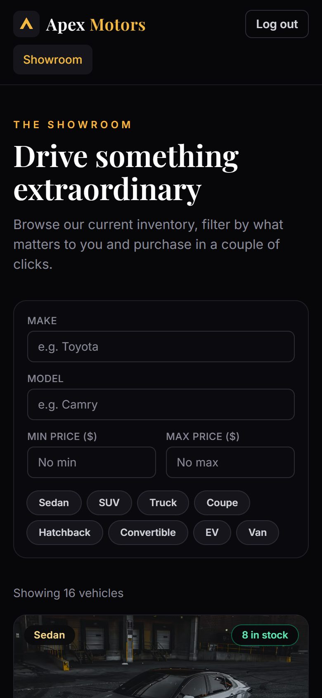

# Apex Motors: Car Dealership Inventory System

A full-stack inventory system for a car dealership, built test-first as part of the Incubyte TDD kata.
Customers can browse, search and purchase vehicles; administrators manage the catalogue and stock.


> **Live demo:** https://car-dealership-inventory-chi.vercel.app (log in with a [demo account](#demo-accounts-created-by-the-seed-script))
> · **API:** https://apex-motors-api-e2gr.onrender.com/api/health
> · **Test report:** [TEST_REPORT.md](TEST_REPORT.md) · **AI chat logs:** [PROMPTS.md](PROMPTS.md)
>
> The API runs on Render's free plan: if it has been idle, the first request can take up to a minute while it wakes up.

---

## Contents

- [Features](#features)
- [Tech stack](#tech-stack)
- [Getting started](#getting-started)
- [Deployment](#deployment)
- [Running the tests](#running-the-tests)
- [API reference](#api-reference)
- [Architecture](#architecture)
- [Design decisions](#design-decisions)
- [Screenshots](#screenshots)
- [My AI Usage](#my-ai-usage)

## Features

**For everyone (logged in)**
- Register and log in; sessions use a JWT that expires after one day.
- Showroom of every vehicle with photo, category, year, colour, price and a colour-coded stock badge.
- Live search and filtering by **make**, **model**, **category** and **price range**. Results update as you type.
- **Purchase** any in-stock vehicle: choose a quantity (capped at the stock), see the total, confirm.
  The Purchase button is **disabled when quantity is zero**.

**For administrators**
- A dedicated **Inventory** page with summary stats (models, units, sold-out count, stock value).
- **Add**, **edit** and **delete** vehicles (deletion requires confirmation).
- **Restock** vehicles, including bringing sold-out cars back.

**Quality details**
- Purchases are atomic: two buyers racing for the last car can never oversell it (there is a test for this).
- Validation on both sides: instant feedback in the UI, with the API as the source of truth.
- Accessible: labelled inputs, keyboard-friendly dialogs (Escape closes, focus is managed), ARIA roles.
- Responsive from phone to desktop; loading skeletons, empty states and error/retry states.

## Tech stack

| Layer | Technology |
| --- | --- |
| Backend | Node.js, TypeScript, Express 5 |
| Database | SQLite (file-based) via Prisma ORM |
| Auth | JWT (`jsonwebtoken`) + bcrypt password hashing |
| Validation | Zod |
| Frontend | React 19, TypeScript, Vite, Tailwind CSS v4, React Router |
| Backend tests | Jest, Supertest (against a real SQLite test database) |
| Frontend tests | Vitest, React Testing Library, user-event |

## Getting started

### Prerequisites

- **Node.js 20+** and npm
- Git

No database server is needed: SQLite stores everything in a single file.

### 1. Clone

```bash
git clone https://github.com/chinmayghosh/car-dealership-inventory.git
cd car-dealership-inventory
```

### 2. Backend (API on http://localhost:4000)

```bash
cd backend
npm install                 # also generates the Prisma client
cp .env.example .env        # Windows (cmd): copy .env.example .env
npx prisma db push          # creates the SQLite database from the schema
npm run seed                # creates the admin, a demo user and 16 sample vehicles
npm run dev                 # starts the API with auto-reload
```

### 3. Frontend (app on http://localhost:5173)

In a second terminal:

```bash
cd frontend
npm install
npm run dev
```

Open **http://localhost:5173**. In development Vite forwards `/api` requests to the backend, so no extra configuration is needed.

### Demo accounts (created by the seed script)

| Role | Email | Password |
| --- | --- | --- |
| Admin | `admin@dealership.com` | `Admin@123` |
| Customer | `user@dealership.com` | `User@123` |

You can also register a new account; new accounts are always customers.

### Environment variables

**`backend/.env`**

| Variable | Purpose | Default |
| --- | --- | --- |
| `DATABASE_URL` | SQLite file location | `file:./dev.db` |
| `JWT_SECRET` | Secret used to sign tokens. **Change it in production.** | – |
| `JWT_EXPIRES_IN` | Token lifetime | `1d` |
| `PORT` | API port | `4000` |
| `CORS_ORIGIN` | Allowed frontend origin(s), comma-separated | `http://localhost:5173` |
| `ADMIN_EMAIL` / `ADMIN_PASSWORD` | Admin account created by `npm run seed` | see above |

**`frontend/.env`** (optional)

| Variable | Purpose |
| --- | --- |
| `VITE_API_URL` | Backend origin for production builds. Leave empty in development. |

### Production builds

```bash
cd backend && npm run build && npm start      # compiled API
cd frontend && npm run build                  # static files in frontend/dist
```

## Deployment

The backend runs on **Render** and the frontend on **Vercel**, both on free plans.

| Part | Platform | Config |
| --- | --- | --- |
| API | Render web service: https://apex-motors-api-e2gr.onrender.com | [`render.yaml`](render.yaml) (Blueprint), start command `npm run start:prod` |
| SPA | Vercel (Vite preset, root directory `frontend`): https://car-dealership-inventory-chi.vercel.app | [`frontend/vercel.json`](frontend/vercel.json) rewrites all routes to `index.html`; `VITE_API_URL` points at the API |

**Free-plan trade-offs (intentional for a demo):**
- Render's free plan has no persistent disk, so `start:prod` recreates the SQLite schema and re-runs the seed on
  every start. The live demo therefore **resets to the sample inventory** whenever the service restarts.
  For persistent production data, switch the Prisma datasource to PostgreSQL.
- Free Render services sleep after ~15 minutes of inactivity; the first request afterwards can take ~50 seconds.

## Running the tests

```bash
cd backend && npm test             # 91 tests
cd backend && npm run test:coverage
cd frontend && npm test            # 64 tests
cd frontend && npm run test:coverage
```

To regenerate the full report for both suites:

```bash
node scripts/generate-test-report.mjs
```

| Suite | Tests | Line coverage |
| --- | --- | --- |
| Backend | 91 passing | 100% |
| Frontend | 64 passing | 98% |

See **[TEST_REPORT.md](TEST_REPORT.md)** for every test case and per-file coverage.

Backend tests run against a separate `test.db` that is rebuilt from the Prisma schema on every run,
so they exercise real SQL, constraints and the atomic purchase logic, not mocks.

## API reference

All endpoints return JSON. Errors have the shape `{ "message": string, "errors"?: [{ "field", "message" }] }`.
Protected endpoints need the header `Authorization: Bearer <token>`.

### Auth

| Method | Endpoint | Access | Body | Success |
| --- | --- | --- | --- | --- |
| POST | `/api/auth/register` | Public | `{ name, email, password }` (password ≥ 6 chars) | `201 { token, user }` |
| POST | `/api/auth/login` | Public | `{ email, password }` | `200 { token, user }` |

### Vehicles

| Method | Endpoint | Access | Notes |
| --- | --- | --- | --- |
| GET | `/api/vehicles` | Logged in | All vehicles, newest first, including sold-out ones |
| GET | `/api/vehicles/search` | Logged in | Query: `make`, `model` (partial, case-insensitive), `category`, `minPrice`, `maxPrice` (inclusive) |
| POST | `/api/vehicles` | **Admin** | Create. Required: `make, model, category, price, quantity`. Optional: `year, color, imageUrl, description` |
| PUT | `/api/vehicles/:id` | **Admin** | Partial update (any subset of the fields above) |
| DELETE | `/api/vehicles/:id` | **Admin** | `204 No Content` |
| POST | `/api/vehicles/:id/purchase` | Logged in | Body `{ quantity? }` (default 1). `409` if not enough stock |
| POST | `/api/vehicles/:id/restock` | **Admin** | Body `{ quantity }` (≥ 1) |

`category` must be one of: `Sedan, SUV, Truck, Coupe, Hatchback, Convertible, EV, Van`.

**Status codes:** `400` validation failed · `401` missing/invalid/expired token · `403` not an admin ·
`404` vehicle not found · `409` email already registered or not enough stock.

Example:

```bash
curl -X POST http://localhost:4000/api/auth/login \
  -H "Content-Type: application/json" \
  -d '{"email":"user@dealership.com","password":"User@123"}'

curl "http://localhost:4000/api/vehicles/search?make=toyota&maxPrice=35000" \
  -H "Authorization: Bearer <token>"
```

## Architecture

```
car-dealership/
├── backend/
│   ├── prisma/            schema.prisma, seed.ts
│   ├── src/
│   │   ├── app.ts         composition root: wires repositories → services → controllers → routes
│   │   ├── server.ts      starts the HTTP server
│   │   ├── middleware/    authenticate, requireAdmin, validate (Zod), errorHandler
│   │   ├── modules/
│   │   │   ├── auth/      schemas, user.repository, auth.service, controller, routes
│   │   │   └── vehicles/  schemas, vehicle.repository, vehicle.service, controller, routes
│   │   ├── errors/        HttpError
│   │   └── utils/         jwt helpers
│   └── tests/             integration tests per endpoint + service unit tests
├── frontend/
│   └── src/
│       ├── api/           typed fetch client + one function per endpoint
│       ├── context/       AuthContext (session), ToastContext (notifications)
│       ├── components/    VehicleCard, FilterBar, PurchaseDialog, VehicleForm, Modal, …
│       ├── pages/         Login, Register, Showroom, Inventory (admin), 404
│       └── hooks/, lib/   debounce hook, formatting and error helpers
├── scripts/               generate-test-report.mjs
└── docs/screenshots/
```

**Backend layering (SOLID):** each request flows `route → middleware → controller → service → repository → Prisma`.
- *Single responsibility*: controllers only translate HTTP, services hold business rules, repositories only talk to the database.
- *Dependency inversion*: services depend on `VehicleRepository` / `UserRepository` **interfaces**. The real app injects Prisma
  implementations in `app.ts`; the unit tests inject an in-memory fake, which proves the business rules are independent of the database.
- *Open/closed*: validation, authentication and authorisation are composable middleware, added per route without touching handlers.

## Design decisions

| Decision | Why |
| --- | --- |
| **Admins come only from the seed script**; registration always creates customers, even if `role: "ADMIN"` is sent | Prevents anyone granting themselves admin rights. |
| **Add and update are admin-only** (not just "protected") | The brief puts add/update/delete under the admin UI; letting customers edit prices would make no sense for a dealership. |
| **Sold-out vehicles stay in the list** with a disabled Purchase button | Required by the brief, and it tells customers what normally exists. |
| **Purchase takes an optional quantity** (default 1) | More realistic than one-per-click; still compatible with a bodyless request. |
| **Atomic conditional UPDATE for purchases** | `UPDATE … WHERE quantity >= n` checks and decrements stock in one statement, so concurrent purchases cannot oversell. |
| **409 Conflict for insufficient stock** | The request is valid but conflicts with the current state of the resource. |
| **Same error for unknown email and wrong password** | Avoids revealing which emails are registered. |
| **Fixed category list** | Keeps data clean and powers the category filter chips. |
| **SQLite via Prisma** | Zero-setup for reviewers (no DB server) while still a real, persistent database; Prisma makes moving to PostgreSQL a one-line provider change. |

## Screenshots

| | |
| --- | --- |
| **Login**  | **Register**  |
| **Showroom**  | **Search & filter** (Coupe, max $50,000; sold-out car disabled)  |
| **Purchase dialog**  | **Admin inventory**  |
| **Admin: add vehicle**  | **Admin: restock**  |

<p align="center"><b>Mobile</b><br></p>

Vehicle photos are from [Unsplash](https://unsplash.com) and are loaded from their CDN.

## My AI Usage

### Tools used

- **Claude Code** (Anthropic), using the **Claude Opus 5.5** model, in the Claude desktop app.

### How I used it

I worked with Claude Code as a pair programmer where I acted as the product owner and decision-maker, and the AI wrote the code.

- **Requirements and planning.** I gave it the kata PDF and asked it to ask me questions before writing anything.
  It came back with decisions for me to make, and I chose: Node/TypeScript + Express, SQLite via Prisma,
  admins created only by a seed script, admin-only add/update, purchase with a quantity, a fixed category list,
  showing sold-out cars with a disabled button, a dark "premium showroom" look with a gold accent,
  a separate admin Inventory page, a live filter bar and a confirmation dialog for purchases.
- **Test-driven development.** For each feature, the AI wrote the failing tests first and committed them (`test: … (red)`),
  then wrote the implementation (`feat: … (green)`), then refactored. The commit history shows this cycle.
- **Code generation.** All backend and frontend code, the seed data and the test-report script were written by the AI
  following that cycle, with me reviewing at checkpoints (after the backend and after the frontend) before moving on.
- **Verification and debugging.** The AI ran the app in a browser and caught issues tests had not:
  unreadable stock badges on bright photos, a modal that stole focus from its first input, and a cramped mobile navbar.
  For the focus bug it wrote tests, confirmed they failed against the old code, then fixed it.
- **Documentation.** This README and the test report were drafted by the AI and reviewed by me.
- **Deployment.** The AI prepared the Render and Vercel configuration and tested it locally; I created the accounts,
  pushed the repository and deployed both services myself, then the AI verified the live site.

Every commit where AI was used carries a `Co-authored-by: Claude Opus 5.5 <noreply@anthropic.com>` trailer.
The complete chat log is in [PROMPTS.md](PROMPTS.md); the few mechanical changes made when converting it
(truncated long outputs, omitted screenshots, my email redacted) are listed at its top.

### Reflection

AI sped up almost every part of this project: the project setup and tooling, turning the requirements into test cases,
building a polished and responsive UI, and writing the documentation and test report. Work that would normally take me
days of setup and boilerplate was done in hours, which let me spend my attention on decisions instead of typing.

Those decisions are where I felt my own judgement mattered most. The kata leaves a lot open, so I had to decide the
scope: making add and update admin-only, letting customers buy more than one unit, and keeping sold-out cars visible.
I also chose the tech stack (Express, SQLite with Prisma, a seeded admin account, Render and Vercel) and set the design
direction: the dark showroom look, the gold accent and a separate admin page.

Honestly, seeing the app working in the browser convinced me more than the tests did. The red-then-green commits are
good evidence that each feature does what was asked, but it was the browser checks that caught the problems the tests
missed: badges you could not read on bright photos, a dialog that stole keyboard focus, and a cramped mobile navbar.
That taught me that tests prove the behaviour you thought to specify, and you still need to look at the real thing.

Next time I would do three things differently. I would write at least part of the code myself, to understand it more
deeply than I can by directing it. I would read the generated code more closely, line by line, instead of mostly judging
it by its results. And I would push back more: I accepted the AI's recommended option for many choices, and I want to
get better at questioning those recommendations and arguing for alternatives.
